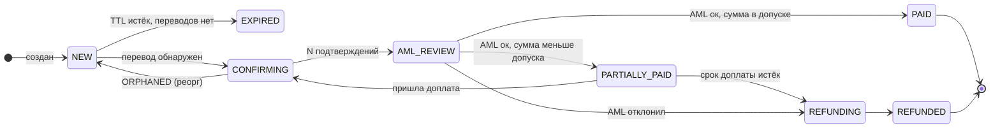

# Дизайн-документ: приём платежей в USDT (ERC-20)

Сервис принимает USDT на Ethereum для нескольких партнёров, проверяет средства через AML и зачисляет их партнёру за вычетом комиссии или возвращает отправителю. Допущения помечены словом **Допущение**.

## 1. Архитектура

### 1.1. Компоненты

Один Go-бинарник, роли запускаются отдельными процессами одного образа, общая PostgreSQL. Роли общаются через таблицы-очереди и outbox в той же БД, брокера в первой версии нет.

| Компонент | Что делает |
|---|---|
| **API** | REST для партнёра: создать счёт (идемпотентно), статус счёта, баланс. Статический API-ключ. |
| **Chain Watcher** | Сканирует блоки, находит переводы USDT на наши адреса, ведёт подтверждения и реорги. |
| **Payment Processor** | Запускает AML, делает проводки, считает недоплату и переплату. |
| **AML Worker** | Ходит к провайдеру через интерфейс `RiskChecker`, повторяет при недоступности, ручные случаи отдаёт оператору. |
| **Refund Worker** | Удерживает газ, подливает ETH, отправляет USDT, следит за подтверждением. |
| **Webhook Dispatcher** | Доставляет события партнёру из outbox с ретраями и подписью. |
| **Ledger** | Двойная запись, суммы в `BIGINT` в базовых единицах (1 USDT = 10⁶), никаких float. |
| **Admin** | Внутренний API: очередь AML, ручные возвраты, сверка, настройки партнёра. |
| **Signer** | Единственный процесс с доступом к ключам: получает транзакцию, возвращает подпись. |

Поток: `счёт → Watcher видит Transfer → N подтверждений → AML → проводка → outbox → вебхук`.

### 1.2. Обнаружение переводов

**Собственный сканер через `eth_getLogs`.** Подписка теряет события при обрыве соединения. Внешний индексер — лишняя зависимость, которую не проверить в тесте. Сканер — цикл по блокам `tip+1 … head` с фильтром `address` = контракт USDT, `topic0` = `Transfer`.

- **Поддельный «USDT»** отсекаем по адресу контракта, имя и символ токена не читаем.
- **Неуспешная транзакция:** для каждого нашего лога проверяем receipt со `status == 1`.
- **Подтверждения:** `N = 12` (~2,5 мин, **Допущение**). Перевод сначала `DETECTED`, после N блоков `CONFIRMED`. На ledger влияет только `CONFIRMED`. Для крупных сумм в проде ждём `finalized`.
- **Реорги:** храним `(number, hash, parent_hash)` просканированных блоков и сверяем `parent_hash` каждого нового. При расхождении откатываемся к общему предку (лимит 64 блока), переводы из выброшенных блоков помечаем `ORPHANED`. До N подтверждений проводок нет, поэтому ledger откатывать не нужно. Реорг глубже N — остановка сканера и алерт.

### 1.3. Адреса и ключи

Один адрес на счёт из HD-кошелька (BIP-32, `m/44'/60'/0'/0/{index}`). API знает только **xpub**, приватные ключи выводятся только внутри Signer.

**Первая версия:** seed зашифрован в облачном KMS, расшифровать его может только IAM-роль Signer. Seed не передаётся через env и не попадает в логи; exec и core dump в контейнер отключены. Подпись ограничена дневным лимитом и белым списком адресов, чтобы взломанный API не вывел всё разом. Остаточный риск — root на хосте Signer.

**В проде:** MPC или HSM-провайдер (Fireblocks, Dfns и т. п.) с политиками: лимиты, белые списки, одобрение двумя людьми, аудит подписей. Провайдера выбираем до выхода из пилота, потому что смена означает перевыпуск всех адресов. Решает стоимость: при малом объёме минимальный контракт может съесть всю выручку.

### 1.4. Уведомления партнёра

Вебхуки **at-least-once**: событие пишется в `webhook_outbox` в одной транзакции со сменой статуса. Ретраи экспоненциальные, от 1 минуты до 24 часов, после 20 попыток — `FAILED` и алерт. В событии есть `event_id` для дедупликации. Подпись: `X-Signature: t=<unix>,v1=HMAC-SHA256(secret, t + "." + body)`, окно 5 минут против replay. Источник правды — `GET /invoices/{id}`, вебхук только сигнал.

### 1.5. Что сломается при 1 млн счетов в день

Это ~12 счетов/с — не нагрузка для API и PostgreSQL. Ломаются экономика и операционка:

1. **Свип с миллиона адресов.** Каждый адрес — подлив ETH плюс перевод USDT, около 5 долларов, итого ~5 млн долларов в день. Решение: один адрес на пару «партнёр + клиент», свип по порогу и при дешёвом газе. Затем forwarding-контракты через `CREATE2`: деплой и свип одной транзакцией без подлива ETH.
2. **Фильтр адресов в `eth_getLogs`.** Провайдеры ограничивают размер `topics`. Сканируем все `Transfer` USDT и фильтруем по хэш-сету своих адресов.
3. **Горячий баланс крупного партнёра.** Баланс считаем агрегатом по проводкам со снапшотами, без блокировки одной строки.
4. **AML и вебхуки:** рейт-лимиты провайдера и медленные партнёры. Пул воркеров, outbox переносим в Kafka или NATS.

## 2. Деньги

### 2.1. Статусы

Статус счёта выводится из его переводов. Перевод: `DETECTED → CONFIRMED → CREDITED | REJECTED`, при реорге — `ORPHANED`. Возврат — отдельная сущность: `NEEDS_ADDRESS` (биржа) `→ READY_TO_SEND → FUNDING_GAS → SENT → CONFIRMED`, тупиковые `DUST` и `FAILED`. Уникальный индекс `refunds(transfer_id)` гарантирует один возврат на перевод.

### 2.2. Счета ledger и проводки

Счета: `asset:deposits` (USDT на наших адресах), `liab:partner:{id}:hold` (ждёт AML), `liab:partner:{id}:available` (доступно партнёру), `liab:refunds_payable` (должны отправителям), `rev:fees`, `rev:gas_recovery`; в ETH — `asset:gas_tank` и `exp:gas`. Холд — один счёт на партнёра, долг по возвратам — общий; детали по счетам и возвратам хранятся в своих таблицах. Баланс каждой проводки проверяют код и отложенный триггер в БД, ledger append-only. Комиссия 1 % (**Допущение**).

| Случай | Дебет | Кредит |
|---|---|---|
| **Подтверждён, ждёт AML** (100 USDT) | `asset:deposits` 100 | `liab:partner:P:hold` 100 |
| **AML ок** | `liab:partner:P:hold` 100 | `liab:partner:P:available` 99 · `rev:fees` 1 |
| **AML отклонил** | `liab:partner:P:hold` 100 | `liab:refunds_payable` 100 |
| **Возврат отправлен** (газ 3 USDT) | `liab:refunds_payable` 100 | `asset:deposits` 97 · `rev:gas_recovery` 3 |
| **Газ потрачен** (ETH) | `exp:gas` 0.001 | `asset:gas_tank` 0.001 |

Холд партнёр видит как `on_hold`, но тратить не может. Сверка: `asset:deposits` равен сумме USDT на наших адресах on-chain, расхождение — алерт.

### 2.3. Газ для возврата

Без ETH на депозитном адресе USDT не отправить. `permit` USDT не поддерживает, forwarding-контракт отложен (журнал, п. 1). **Выбор:** Refund Worker подливает ETH из `asset:gas_tank` на один перевод с запасом 20 %, затем Signer подписывает перевод USDT. **Платит отправитель:** газ по курсу удерживается из суммы. Если сумма меньше стоимости газа, возврат уходит в `DUST`, деньги остаются на `liab:refunds_payable` (судьба — юридический вопрос, **Допущение**).

## 3. Продуктовые вопросы

**1. Недоплата 3 %.** Счёт переходит в `PARTIALLY_PAID`. Клиент видит «получено 97 из 100, доплатите 3 USDT за 1 час», партнёр получает вебхук с суммой и дедлайном, поддержка — счёт в списке «ждут доплату». Допуск и срок настраиваются на партнёра (например, 3 %, но не больше 20 USDT, и 1 час). Недоплата в пределах допуска считается оплатой. Если срок истёк — автоматический возврат за вычетом газа. Переплата зачисляется целиком.

**2. AML отклонил.** Платит отправитель: газ удерживается из суммы. Партнёру ничего не зачисляем и комиссию не берём. Если сумма меньше стоимости газа — `DUST`. Если платёж пришёл с биржи (по меткам AML и нашему списку горячих кошельков), на исходный адрес не возвращаем, это общий кошелёк. Отправитель подтверждает вывод из своего аккаунта и указывает адрес, адрес проходит AML, только потом отправляем.

**3. Комиссия.** Процент от суммы, настраивается на партнёра, старт 1 %. Фикс несправедлив к мелким чекам, а газ — лишь часть расходов. Ставка фиксируется в счёте и проводке, поэтому смена тарифа не меняет историю. В отчёте партнёр видит по каждому счёту валовую сумму, комиссию и чистое зачисление.

**4. Метрики.**

| Партнёру в кабинете | Зачем |
|---|---|
| Объём принятых платежей за день и месяц | Оборот через сервис |
| Чистые зачисления и комиссии | Сколько получил партнёр и сколько стоит сервис |
| Доля оплаченных счетов | Проблемы с оплатой |
| Доля и сумма возвратов по причинам | Отличать недоплаты от AML-отказов |
| Сумма на проверке и время ожидания | Какие деньги ещё недоступны |

| Внутренней команде | Зачем |
|---|---|
| Очередь AML: количество, сумма, возраст старейшей | Задержки и зависшие деньги |
| Ручные возвраты: количество, сумма, возраст | Нагрузка поддержки и обязательства |
| Отставание сканера от головы цепи | Сервис перестал видеть платежи |
| Расхождение ledger с on-chain балансами | Ошибки учёта |
| Доход от комиссий минус газ и AML | Сходится ли экономика |

**5. Две недели, два разработчика.** Выпускаем один путь: счёт → перевод → подтверждения → ручная AML-очередь → оператор разрешил → зачисление и вебхук. Плюс ledger, идемпотентность и админка в виде API. Откладываем: автоматический AML, автоматические возвраты (оператор отправляет вручную, проводки те же), доплату (в v1 недоплата идёт в ручной возврат), UI, свип. Деньги и учёт должны быть верными с первого дня, остальное неделю-две можно делать руками.

## 4. Журнал решений

1. **Депозитные адреса — обычные HD-кошельки, а не свой контракт.** Сначала планировал forwarding-контракт через `CREATE2`, чтобы свип и возврат шли одной транзакцией. **Передумал:** разработка и аудит контракта — неделя и риск без выгоды для пилота. Цена — газ на адресе депозита, его решает газовый кошелёк. Контракт вернётся при масштабировании.
2. **Свой сканер блоков вместо подписки или индексера.** Подписка теряет события, индексер не проверить в тестах. Сканер с курсором в БД детерминирован и повторяем.
3. **Ручная AML в первой версии.** Интеграцию откладываю ради срока; каждый платёж всё равно проверяется до зачисления, интерфейс `RiskChecker` тот же.
4. **Процентная комиссия на партнёра.** Отказался от комиссии по среднему газу: газ — лишь часть расходов.
5. **Возврат оплачивает отправитель.** Если платит сервис, появляется вектор атаки: заливать грязные мелкие суммы и тратить наш газ.
6. **Недоплата — доплата в срок, а не немедленный возврат.** Допуск и срок настраиваются на партнёра.
7. **Биржевой платёж — возврат только после ручной проверки.** Исходный адрес может быть общим кошельком биржи; адрес возврата запрашиваем у плательщика и проверяем через AML.
