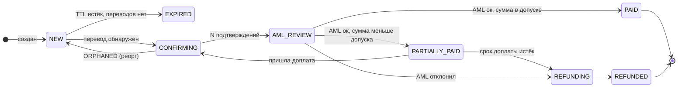

# Дизайн-документ: приём платежей в USDT (ERC-20)

Сервис принимает USDT на Ethereum для нескольких партнёров, проверяет входящие средства через AML, зачисляет их на баланс партнёра за вычетом комиссии или возвращает отправителю. Ниже — решения для первой версии и то, что меняется в проде. Допущения помечены словом **Допущение**.

## 1. Архитектура

### 1.1. Компоненты

Один Go-бинарник, несколько ролей (запускаются как отдельные процессы одного образа), общая PostgreSQL. Всё взаимодействие между ролями идёт через таблицы в той же БД (outbox/очередь задач), без брокера в первой версии.

| Компонент | Что делает |
|---|---|
| **API** | Партнёрский REST: создать счёт (идемпотентно), статус счёта, баланс, список операций. Статический API-ключ на партнёра. |
| **Chain Watcher** | Сканирует блоки Ethereum, находит переводы USDT на наши адреса, ведёт подтверждения и реорги. Единственный писатель в таблицу `transfers`. |
| **Payment Processor** | Машина состояний счёта: сопоставляет переводы со счетами, считает недоплату/переплату, запускает AML, делает проводки в ledger. |
| **AML Worker** | Ходит в AML-провайдера за интерфейсом (`RiskChecker`), повторяет при недоступности, складывает ручные случаи в очередь оператору. |
| **Refund Worker** | Готовит возврат: считает удержание за газ, подливает ETH на адрес депозита, подписывает и отправляет USDT, следит за подтверждением. |
| **Webhook Dispatcher** | Доставляет события партнёру из outbox с ретраями и подписью. |
| **Ledger** | Библиотека + таблицы `accounts`/`entries`/`postings`. Двойная запись, суммы в `BIGINT` в базовых единицах USDT (1 USDT = 10⁶), никаких float: весь выпуск USDT (~1,5·10¹⁷ единиц) намного меньше `int64`, а целые исключают ошибки округления. |
| **Admin** | Внутренний API: очередь AML, ручные возвраты, сверка, настройки партнёра. UI откладываем. |
| **Signer** | Отдельный процесс, который единственный имеет доступ к ключам. Получает «подпиши эту транзакцию», возвращает подпись. |

Поток: `API создаёт invoice → Watcher видит Transfer → Processor привязывает к invoice → N подтверждений → AML → проводка в ledger → outbox → webhook`.

### 1.2. Обнаружение входящих переводов

**Выбор: собственный сканер блоков через `eth_getLogs`**, а не подписка и не внешний индексер. Подписка (`eth_subscribe`) теряет события при обрыве соединения, а внешний индексер (Alchemy Notify, Moralis) добавляет зависимость, которую нельзя проверить в тесте. Сканер — это цикл: `last_scanned_block + 1 … head - 0`, запрос логов с фильтром `address = 0xdAC17F958D2ee523a2206206994597C13D831ec7` (контракт USDT), `topic0 = Transfer(address,address,uint256)`, `topic2 ∈ наши адреса`. Ethereum даёт блок раз в 12 секунд, одного потока хватает; батч до 1000 блоков при догоне.

- **Поддельный «USDT».** Фильтруем строго по адресу контракта. Токен с тем же именем, но другим адресом никогда не попадает в выборку. Символ и decimals не читаем из контракта вообще.
- **Неуспешная транзакция.** Логи не эмитятся из отменённых транзакций, но защищаемся дважды: для каждого найденного лога читаем receipt и требуем `status == 1`. Это же отсекает переводы из внутренних вызовов, которые откатились.
- **Подтверждения.** `N = 12` блоков (**Допущение**; ~2,5 минуты). Перевод в статусе `DETECTED` после первого появления, `CONFIRMED` после N. На ledger влияет только `CONFIRMED`. В проде добавлю опцию «ждать `finalized`» для сумм выше порога.
- **Реорги.** Для каждого просканированного блока храним `(number, hash, parent_hash)`. Перед обработкой нового блока сверяем `parent_hash` с хэшем предыдущего в нашей таблице. При расхождении откатываемся до последнего совпадающего блока (глубина обычно 1–2, лимит 64), переводы из отброшенных блоков помечаем `ORPHANED`, счёт возвращается в предыдущий статус. Так как до N подтверждений проводок нет, откатывать ledger не нужно. Реорг глубже N — остановка сканера и алерт, это ручной инцидент.

### 1.3. Адреса для депозита и ключи

Один адрес на счёт, выводим из HD-кошелька (BIP-32, путь `m/44'/60'/0'/0/{index}`). API-процесс знает только **xpub** и может генерировать адреса без приватных ключей; `index` — монотонная последовательность в БД. Приватный ключ для подписи возврата или свипа выводится только внутри Signer.

**Первая версия:** Signer хранит seed зашифрованным в secret-менеджере (envelope encryption через облачный KMS) и расшифровывает его в память при старте. Сетевая изоляция контейнера сама по себе не защищает: до памяти процесса добираются через exec в контейнер, env-переменные, логи, core dump или root на хосте. Поэтому seed не передаётся через env, расшифровать его может только IAM-роль Signer, логирование секретов и сырых транзакций запрещено на уровне кода, exec, core dump и privileged-режим отключены, а подпись ограничена дневным лимитом суммы и белым списком адресов назначения, чтобы взломанный API не мог вывести всё разом. Остаточный риск: seed в открытом виде в памяти процесса доступен тому, кто получил root на хосте. Для пилота это приемлемо, и именно это закрывает переход на MPC или HSM в проде. **В проде:** специализированная инфраструктура кошельков с защищённой подписью (MPC или HSM) и политиками доступа: лимит суммы в сутки, белые списки адресов, одобрение двумя людьми выше порога, аудит каждой подписи. Наш HD-кошелёк и Signer при этом заменяются API провайдера, остальные компоненты не меняются. Кандидаты: Fireblocks, Dfns, Coinbase Prime, свой кластер HSM. Конкретного провайдера выбираем после проверки трёх вещей: как он выдаёт депозитные адреса на счёт и сколько их может быть, как восстанавливаются ключи при потере доступа к провайдеру, и во сколько это обходится при ожидаемом количестве адресов, платежей и подписей. Стоимость здесь решающая: у enterprise-провайдеров есть минимальная цена контракта, и при малом объёме она может съесть всю комиссионную выручку, тогда выгоднее дольше оставаться на собственном Signer с KMS. Честнее оставить эту зависимость от объёмов, чем объявлять конкретного провайдера безусловным выбором для продакшена. Смена провайдера позже означает перевыпуск всех депозитных адресов, поэтому расчёт делаем до выхода из пилота.

### 1.4. Уведомления партнёра

Вебхуки с гарантией **at-least-once**: событие пишется в `webhook_outbox` в одной транзакции с изменением статуса, Dispatcher доставляет с экспоненциальными ретраями (1 мин → 24 ч, до 20 попыток), потом помечает `FAILED` и алертит. Каждое событие несёт `event_id` для дедупликации на стороне партнёра и `invoice_id`. Подпись: заголовок `X-Signature: t=<unix>,v1=HMAC-SHA256(secret, t + "." + body)`, секрет на партнёра, окно 5 минут против replay. Партнёр всегда может опросить `GET /invoices/{id}` — статус в API первичен, вебхук только сигнал.

### 1.5. Что сломается при 1 млн счетов в день

Это ~12 счетов/с, не нагрузка для API и PostgreSQL. Сломается **экономика и операционка адресов**, в таком порядке:

1. **Свип с миллиона адресов.** Каждый адрес требует отдельной транзакции с газом (~65k gas на USDT-перевод плюс подлив ETH). При $5 за свип это $5 млн в день. Решение: переиспользовать адрес для пары «партнёр + клиент», сопоставлять платежи по сумме и времени, а свипать только при накоплении порога и низком газе. Следующий шаг — forwarding-контракты через `CREATE2` (адрес известен до деплоя, деплоим и свипаем одной транзакцией).
2. **Фильтр адресов в `eth_getLogs`.** RPC-провайдеры ограничивают размер `topics`. Переходим на скан всех `Transfer` USDT (~100k/день) и фильтр в памяти по хэш-сету своих адресов или по bloom-фильтру.
3. **Горячие строки баланса партнёра.** Крупный партнёр получит сотни проводок в секунду на один счёт ledger. Убираем материализованный баланс из горячего пути: баланс считаем агрегатом по `postings` с периодическими снапшотами, строка `accounts` не блокируется.
4. **AML и вебхуки.** Рейт-лимиты провайдера и медленные эндпоинты партнёров. Это уже пул воркеров и очередь, в проде вынесем outbox в Kafka/NATS.

## 2. Деньги

### 2.1. Статусы

Перевод (`transfer`) живёт отдельно: `DETECTED → CONFIRMED | ORPHANED`. Один счёт может собрать несколько переводов. Возврат (`refund`) — своя сущность: `CREATED → NEEDS_ADDRESS (биржа) → READY_TO_SEND → FUNDING_GAS → SENT → CONFIRMED`, тупиковые: `DUST` (сумма меньше удержания за газ), `FAILED`. Уникальный индекс `refunds(transfer_id)` гарантирует один возврат на перевод при любых повторах.

### 2.2. Счета ledger и проводки

Счета (все в USDT, кроме газового): `asset:deposits` (USDT на наших адресах), `liab:partner:{id}:hold` (на проверке, партнёру ещё не принадлежит), `liab:partner:{id}:available` (доступно партнёру), `liab:refunds_payable` (должны отправителям), `rev:fees`, `rev:gas_recovery`, `exp:gas` и `asset:gas_tank` (в ETH, отдельная валюта). Холд и долг по возвратам — по одному счёту на партнёра и общий, а не на каждый счёт и возврат: разбивку дают сущности `transfers` и `refunds`, а счетов ledger не становится миллион. Проводка всегда балансируется: сумма дебетов равна сумме кредитов; это проверяет код и отложенный constraint trigger в БД при коммите, а таблицы ledger append-only. Комиссия 1 % (**Допущение**).

| Случай | Дебет | Кредит |
|---|---|---|
| **Перевод подтверждён, ждёт AML** (100 USDT) | `asset:deposits` 100 | `liab:partner:P:hold` 100 |
| **AML ок, зачисление** | `liab:partner:P:hold` 100 | `liab:partner:P:available` 99 · `rev:fees` 1 |
| **AML отклонил, возврат создан** | `liab:partner:P:hold` 100 | `liab:refunds_payable` 100 |
| **Возврат отправлен** (газ оценён в 3 USDT) | `liab:refunds_payable` 100 | `asset:deposits` 97 · `rev:gas_recovery` 3 |
| **Газ фактически потрачен** (ETH) | `exp:gas` 0.001 | `asset:gas_tank` 0.001 |

Пока деньги на `hold`, партнёр видит их в балансе как `on_hold`, но распоряжаться ими не может: доступная сумма не меняется до ответа AML. Сверка: `asset:deposits` должен совпадать с суммой балансов USDT наших адресов on-chain, расхождение — метрика и алерт.

### 2.3. Газ для возврата

USDT с депозитного адреса не отправить без ETH на нём. Варианты: `permit` (USDT его не поддерживает), forwarding-контракт (отложен, см. журнал), account abstraction (избыточно). **Выбор:** Refund Worker делает две транзакции — переводит с `asset:gas_tank` ровно столько ETH, сколько стоит один USDT-перевод с запасом 20 %, затем Signer подписывает перевод USDT с депозитного адреса на адрес возврата. **Платит отправитель:** стоимость газа переводится в USDT по курсу на момент возврата и удерживается из суммы. Если сумма меньше удержания, возврат получает статус `DUST`, средства остаются на `liab:refunds_payable` и списываются в доход раз в месяц (**Допущение**, в проде это юридический вопрос). Остаток ETH на адресе после отправки не возвращаем, он сгорит в пределах запаса. Часть провайдеров кошельков умеет подливать газ на депозитные адреса сами (например, Gas Station у Fireblocks); если выбранный провайдер это даёт, наш Refund Worker остаётся только владельцем статусов и проводок.

## 3. Продуктовые вопросы

**1. Недоплата 3 %.** Счёт переходит в `PARTIALLY_PAID`. Клиент на странице оплаты видит «получено 97 из 100, доплатите 3 USDT в течение 1 часа». Партнёр получает вебхук `invoice.partially_paid` с полученной суммой и дедлайном. Поддержка видит счёт в списке «ожидают доплату» с таймером. Поведение настраивается на партнёра: допуск недоплаты (например, 3 %, но не больше 20 USDT) и срок доплаты (например, 1 час). Если недоплата в допуске, счёт считаем оплаченным на фактическую сумму и сообщаем партнёру обе цифры. Если срок истёк, автоматический возврат за вычетом газа. Переплату зачисляем партнёру целиком и отмечаем в вебхуке.

**2. AML отклонил.** За возврат платит отправитель: удерживаем газ из суммы. Партнёру ничего не зачисляем и комиссию не берём, ему это не стоит ничего. Если сумма меньше стоимости транзакции, отправитель не получает ничего, возврат уходит в `DUST`. Если перевод пришёл с адреса биржи (определяем по меткам провайдера AML и собственному списку горячих кошельков), автоматический возврат на исходный адрес запрещён, он уйдёт на общий кошелёк биржи. Возврат переводим в `NEEDS_ADDRESS`: отправитель подтверждает исходный вывод из своего аккаунта биржи (скрин или ID вывода, проверяет оператор), указывает адрес возврата, этот адрес тоже проходит AML, и только потом возврат готов к отправке.

**3. Комиссия.** Процент от принятой суммы, настраивается на партнёра, старт 1 % как средняя рыночная. Процент, а не фикс, потому что газ — лишь часть расходов сервиса, а фикс несправедлив к мелким чекам. Ставка хранится в настройках партнёра с датой начала действия, а в каждой проводке фиксируется применённая ставка, так что смена тарифа не ломает историю. В ledger видны отдельно: сумма платежа, удержанная комиссия, газ, который мы заплатили, и газ, который удержали у отправителя. В отчёте партнёр видит валовую сумму, комиссию и чистое зачисление по каждому счёту и агрегаты за период.

**4. Метрики.**

| Партнёру в кабинете | Зачем |
|---|---|
| Объём успешно принятых платежей за день и месяц | Оборот через сервис |
| Чистые зачисления и удержанные комиссии | Сколько получил партнёр и сколько стоит сервис |
| Доля оплаченных счетов | Проблемы с оплатой; не каждый счёт означает намерение купить |
| Доля и сумма возвратов по причинам | Отличать недоплаты от AML-отклонений |
| Сумма на проверке и время ожидания | Какие деньги ещё недоступны и почему |

| Внутренней команде в админке | Зачем |
|---|---|
| Очередь AML: количество, сумма, возраст самой старой | Задержки и зависшие деньги |
| Ручные возвраты: количество, сумма, возраст | Нагрузка поддержки и накопление обязательств |
| Отставание сканера от головы цепи, в блоках | Сервис перестал вовремя видеть платежи |
| Расхождение ledger с on-chain балансами | Ошибки учёта и движения денег |
| Доход от комиссий минус газ и AML | Экономика сходится или нет |

**5. Две недели, два разработчика.** Выпускаем один сквозной путь: создание счёта → перевод обнаружен → подтверждения → ручная AML-очередь → оператор разрешил → зачисление и вебхук об успехе. Плюс ledger, идемпотентность, вебхук с подписью и минимальная админка в виде API. Откладываем: автоматический AML-провайдер (ручная проверка ограничит пропускную способность, но для пилота с несколькими партнёрами хватает), автоматические возвраты (оператор отправляет вручную из хот-кошелька, ledger проводки те же), доплату по недоплате (в v1 недоплата сразу идёт в ручной возврат), UI кабинета и админки, свип. Почему так: деньги и учёт должны быть правильными с первого дня, а всё остальное можно делать руками неделю-две без репутационного ущерба.

## 4. Журнал решений

1. **Депозитные адреса — обычные кошельки от HD-ключа вместо своего контракта; в проде ключи у провайдера с защищённой подписью.** Сначала планировал forwarding-контракт через `CREATE2`, чтобы свип и возврат делались одной транзакцией. **Передумал:** разработка и аудит контракта добавляют неделю и риск без обязательной выгоды для пилота. Цена решения — проблема газа на адресе депозита, которую решаем газовым кошельком. Контракт вернётся на этапе масштабирования.
2. **Собственный сканер блоков вместо подписки или внешнего индексера.** Подписка теряет события при обрыве, индексер непроверяем в тестах и добавляет зависимость. Сканер — цикл с курсором в БД, детерминированный и повторяемый.
3. **Ручная AML-проверка в первой версии.** Интеграцию с провайдером откладываю ради срока. Каждый платёж всё равно проходит проверку до зачисления, меняется только исполнитель. Интерфейс `RiskChecker` один и тот же.
4. **Процентная комиссия, настраиваемая на партнёра.** Отбросил идею комиссии от среднего газа: газ отражает только часть расходов. Ставку 1 % считаю допущением до проверки экономики.
5. **Расходы на возврат несёт отправитель.** Партнёру ничего не зачисляется и комиссия не берётся. Альтернатива «платит сервис» создаёт вектор атаки: заливать грязные мелкие суммы и заставлять нас тратить газ.
6. **Недоплата допускает доплату в ограниченный срок.** Вместо немедленного возврата счёт получает статус частичной оплаты. Допуск и срок настраиваются на партнёра, после истечения срока — возврат.
7. **Возврат биржевого платежа только после ручной проверки.** Автоматический возврат на исходный адрес исключён, это может быть общий кошелёк биржи. Адрес возврата запрашивается у плательщика после подтверждения его связи с исходным выводом и отдельной AML-проверки этого адреса.
